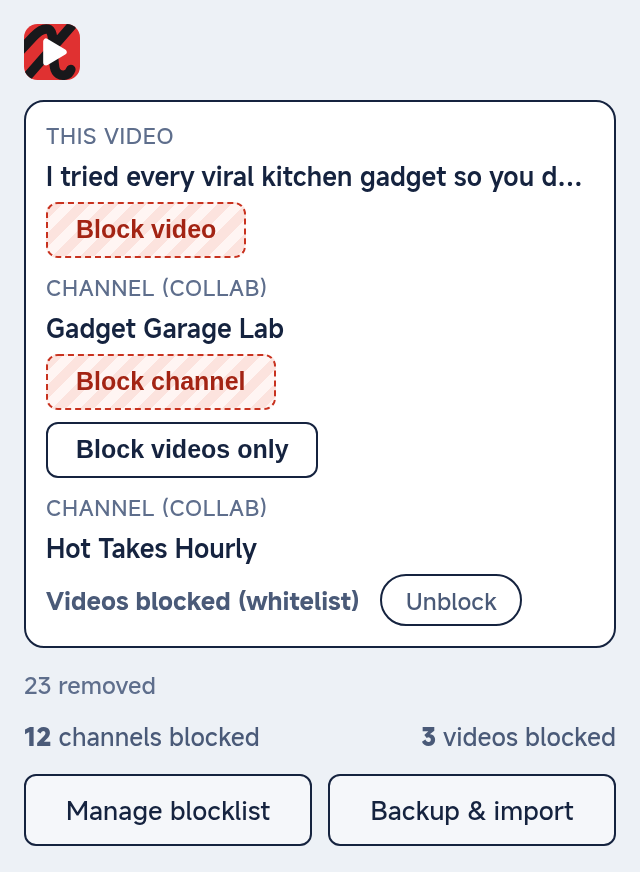
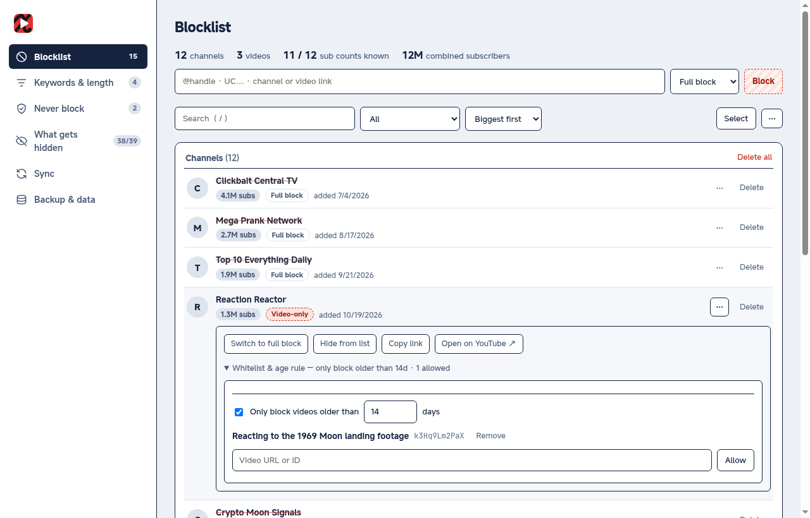
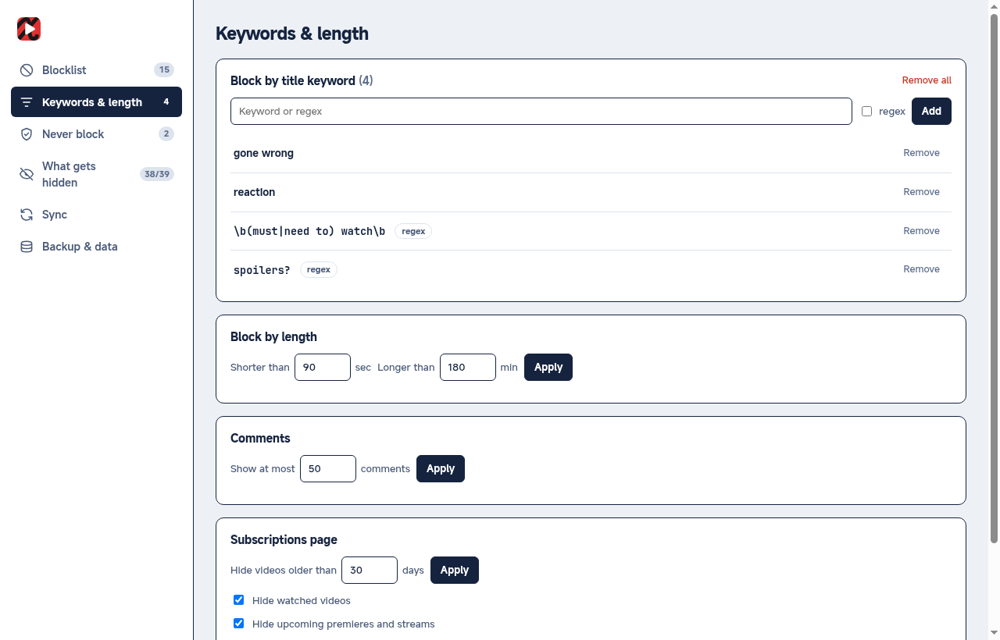
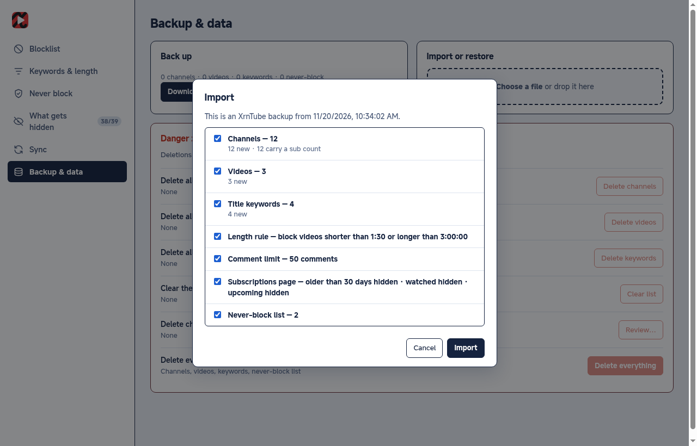
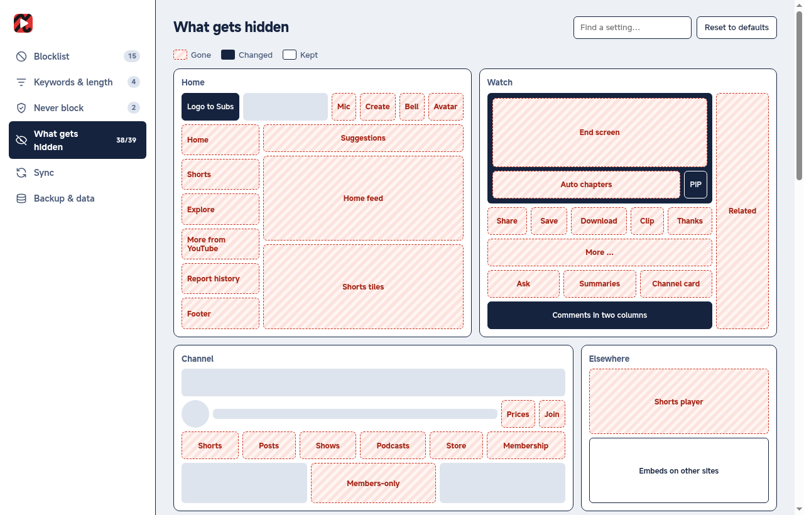
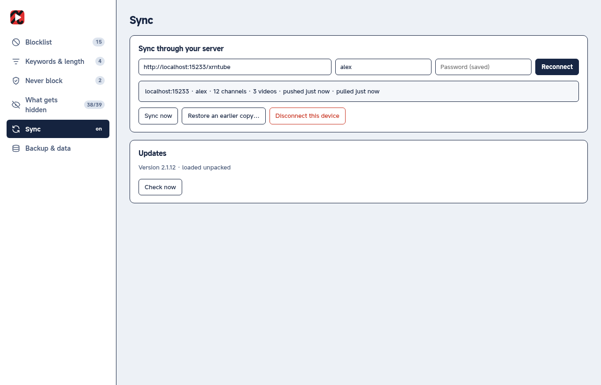

<p align="center">
  
</p>

<h1 align="center">xrntube</h1>

A browser extension that **deletes** blocked YouTube channels and videos from
your feed, search results and recommendations. Not a greyed-out "this channel
is blocked" placeholder — the tile is removed from the page, so a blocked
channel simply stops existing for you.

Works in Chromium browsers: Chrome, Edge or Brave on the desktop, and on an
Android phone in a browser that takes extensions, such as Quetta. It also
runs in Firefox 140+ and Zen. No account,
no telemetry. Your blocklist stays in your browser, and every browser you use
stays on the same list through a tiny sync server you run yourself (one
Python file in `server/`).

**What you can block**

- A **channel** — everything of theirs, everywhere: feeds, search, playlists,
  community posts, comments, and their own channel page.
- A **channel's videos only** — keep the channel reachable, drop its uploads,
  and whitelist individual videos or recent uploads as exceptions.
- A **single video**.
- Anything whose **title matches a keyword or regex**.
- Anything **shorter or longer** than a duration you set.

Plus an optional site cleanup — Shorts, the home feed, the related-videos
column, end-screen suggestions, sidebar clutter and more — as 39 individual
switches you can turn off one by one.

<p align="center">
  
  &nbsp;
  
</p>
<p align="center"><sub>The popup on a video page, and the blocklist with a video-only channel's exceptions open. All names are made up.</sub></p>

---

## Contents

- [Install](#install)
- [Blocking your first channel](#blocking-your-first-channel)
- [Two ways to block a channel](#two-ways-to-block-a-channel)
- [Keyword and length filters](#keyword-and-length-filters)
- [Never-block list](#never-block-list)
- [Managing a big blocklist](#managing-a-big-blocklist)
- [Backup, import and deleting](#backup-import-and-deleting)
- [Importing from the original BlockTube](#importing-from-the-original-blocktube)
- [What gets hidden (site cleanup)](#what-gets-hidden-site-cleanup)
- [Sync between browsers](#sync-between-browsers)
- [Permissions and privacy](#permissions-and-privacy)
- [Troubleshooting](#troubleshooting)
- [Known limitations](#known-limitations)
- [For developers](#for-developers)
- [Licence](#licence)

---

## Install

There is no build step — the extension runs from the source folder exactly as
it is in this repository.

**1. Get the files**

```bash
git clone <this-repo> xrntube
```

…or download the repository as a ZIP and unpack it somewhere permanent. The
browser loads the extension *from that folder*, so don't delete or move it
afterwards.

**2a. Chrome / Edge / Brave**

1. Open `chrome://extensions` (or `edge://extensions`, `brave://extensions`).
2. Turn on **Developer mode** (top-right).
3. Click **Load unpacked** and select the folder you just unpacked.
4. Pin the xrntube icon (a red tile with a play button) to your toolbar if you want the quick-block popup handy.

**2b. Zen / Firefox (140 or newer)**

To keep it installed, in Zen or a Firefox build that allows unsigned
add-ons (Developer Edition, Nightly, unbranded builds):

1. In `about:config`, set `xpinstall.signatures.required` to `false`.
2. Run `npm run package` (it needs no `npm install`) and rename
   `dist/xrntube-<version>.zip` to `xrntube-<version>.xpi`.
3. `about:addons` → ⚙ → **Install Add-on From File…** → that file.

An installed `.xpi` doesn't update itself: install the next version's file
the same way. Release Firefox refuses unsigned files; sign the zip with an
unlisted upload to addons.mozilla.org instead.

To try it without installing: `about:debugging` → **This Firefox** →
**Load Temporary Add-on…** → `manifest.json` in the folder. Firefox drops a
temporary add-on when it closes; until then it reloads itself when the
folder's version changes.

If the popup says **No access to YouTube**, click **Allow on YouTube**
(Firefox can withhold an extension's site access, and it can be switched off
in `about:addons` → xrntube → **Permissions**), then reload YouTube. The
`.crx` self-update below is Chromium-only.

**2c. On your phone (Quetta or another Chromium browser with extensions)**

The phone installs a signed `.crx` from your sync server once, and from then
on fetches every new version from there by itself.

1. On the computer, once: create `~/.config/xrntube/release.json` with your
   server's public address and its ssh host —
   `{ "server": "https://<your-server>/xrntube", "ssh": "<ssh-host>" }` (or a
   list of ssh hosts, tried in order, if there's more than one way in) —
   then `npm run release`. That signs `dist/xrntube-<version>.crx` and puts it
   at `https://<your-server>/xrntube/update/xrntube.crx`. It releases only
   from `master` with everything committed (`--force` releases anyway). The
   first release, `npm run release -- --new-key`, also makes the signing key,
   `~/.config/xrntube/xrntube.pem`: **back it up**. Every update has to be
   signed with that key, and without it the phone has to install afresh
   under a new extension ID, so a later release with the file missing, or
   with a key whose ID isn't the one the server's `updates.xml` names, stops
   before anything is sent.
2. On the phone, open that link in Quetta → **Download anyway** → **OK** to
   add it. (Quetta's Extensions page also takes the file: **from
   .zip/.crx/.user.js**.) If Quetta may not post notifications, Android can
   call it "not responding" a few seconds after the download — its download
   service needs one. Tap **Wait**, or allow Quetta notifications first.
   Updates later don't go through downloads and don't hit this.
3. Open the extension's options → **Sync** and connect it to your server, so
   it picks up your list.

Options → **Sync** → **Updates** shows the version and where it updates
from; **Check now** looks straight away instead of waiting the few hours the
browser takes on its own. xrntube also checks hourly by itself, reading your
server's update file first and asking the browser only when there's a newer
version, so a release usually reaches a phone within the hour. A copy loaded from a `.zip` (`npm run package`) also
works, but is unpacked and never updates.

If your browser only installs from a store, publish the zip to the Chrome Web
Store as **Unlisted** (one-time $5 developer fee): only someone with the link
can find it, and updates arrive automatically. Your server's address and
password are never in the package — you type them into the Sync page.

On the phone, tap a tile's ⋮: xrntube's block options are at the bottom of
the sheet YouTube opens, under its own.

**Checking it on the phone.** The test suite runs the mobile site in
emulation, so a real phone is worth a two-minute look after installing or
updating:

1. Search for a channel you've blocked: its videos shouldn't appear at all,
   not even for a moment.
2. Open the popup on that search page. The grey line should say **N
   removed** with no "late". A **⚠** line means the early filter isn't
   running on the phone (see Troubleshooting).
3. Tap the YouTube logo: it should open Subscriptions without passing through
   the home feed.
4. Tap a tile's ⋮ → **Block channel**: the tile goes, and after the next
   sync the channel is blocked on your other devices too.
5. Open a video: nothing should be listed under it (the related videos are
   one of the switches in **What gets hidden**), and no Share / Save /
   Report buttons.

**Updating** happens by itself. A copy loaded unpacked from a folder reloads
itself when that folder's `manifest.json` names a new version (after a
`git pull`, or after `npm run release` bumped a version the server already
had), the next time anything
wakes it or within the hour — also when the browser was closed at the time.
The phone's `.crx` takes each version `npm run release` publishes. Either
way, refresh any YouTube tab you already had open — content scripts only
attach at page load. Edits that don't change the version still need
**Reload** in `chrome://extensions` (restarting the browser isn't enough: it
keeps the background code it had), and so does a copy loaded before 2.1.0,
once, since that one has nothing to update itself with.

---

## Blocking your first channel

Four ways, all equivalent:

| where | how |
|---|---|
| **On a tile** | Click the tile's ⋮ (YouTube's own menu) → xrntube's options are at the bottom, under YouTube's: *Block this video*, *Block channel: X*, *Block all videos from X*. A banner confirms it, with an **Undo**. A tile with no ⋮ (a channel card in search) is blocked from the popup or by right-click |
| **Right-click** | Right-click a video or channel link (or anywhere on a watch page) → **xrntube: block this channel** / **block this video** |
| **Toolbar popup** | On a video or channel page, click the xrntube toolbar icon — it lists the video and every channel it found, with both block modes per channel (and an **Unblock** button for anything already blocked) |
| **Options page** | Paste into the **Block something** box at the top of the Blocklist tab — `@handles`, `UC…` IDs, channel links, video links, several at once |

A tile that credits several channels (YouTube's collaboration attribution)
offers each one separately, so you can block the collaborator without the
uploader.

Blocked by mistake? Unblock it from the popup, or press **Delete** on its row
in the options page — the confirmation toast has an **Undo**, and **Recently
removed** at the bottom of the Blocklist tab can restore any of the last 40
deletions, mass deletions included.

---

## Two ways to block a channel

Everywhere a channel can be blocked, you get both:

- **Block channel** — the hard option. Their page redirects to Subscriptions,
  and every video, playlist, community post and comment of theirs is removed
  wherever it appears.
- **Block videos only** — the soft option. The channel's own
  page stays reachable and both its channel card and the big channel panel
  search shows for a name query stay visible (with their video lists emptied),
  but its videos are removed everywhere. Their comments stay too, since you didn't
  block *them*, you blocked their uploads.

A soft-blocked channel gets a panel in the options page with two exceptions
you can grant:

- **A whitelist** — paste a video URL or a bare 11-character ID and that one
  video always plays.
- **"Only block videos older than N days"** — hide the back catalogue, keep
  the last N days of uploads. Useful for a channel you want to keep half an
  eye on. Relative dates ("3 days ago") are understood in about 15 languages;
  a video whose age can't be read is never blocked by this rule — **except
  Shorts**, which YouTube never stamps with a date at all (a Shorts tile shows
  a title and a view count and nothing else). Those are treated as old, or an
  age rule would leave a channel's entire Shorts tab on display. Whitelist a
  short by URL if you want it back.

You can flip a channel between the two modes at any time from the same panel.
A directly-blocked *video* has no modes — there's nothing softer than blocking
one video.

---

## Keyword and length filters

The **Keywords & length** tab holds the filters that apply to every video,
from any channel:

- **By title** — a list of words or phrases; any video whose title contains
  one is removed from feeds and search, and opening it directly bounces you
  out. Matching is case-insensitive. Tick *regex* on a row to treat it as a
  regular expression (a malformed one is ignored rather than breaking the
  page). Paste several lines to add them all at once; **Remove all** clears
  the list (undoable).
- **By length** — *shorter than N seconds* and/or *longer than N minutes*.
  Anything outside the range goes. Handy for cutting Shorts-length clips or
  three-hour streams. Leave a field blank for "no limit".
- **Comment cap** — *Show at most N comments* stops a video's comment
  section scrolling forever. It keeps the first N top-level threads, then
  removes the sentinel YouTube uses to page in more, and says so at the
  bottom of the list. Replies are left alone: the cap is about how far the
  section scrolls, not about hiding half of a conversation you opened.
  Defaults to 50; set it to 0 for no cap.
- **Subscriptions page** — three rules for your Subscriptions feed only, from
  every channel (Home, search and channel pages are left alone):
  - *Hide videos older than N days* keeps the feed to what's new: anything N
    days old or older goes. Scroll past the limit and the feed stops loading
    and says so, rather than paging in old videos only to remove them. Blank
    or 0 turns it off.
  - *Hide videos you've watched* drops anything you've watched 90% or more of
    the way through. One you left half-way stays.
  - *Hide premieres and scheduled streams* drops what hasn't aired yet. Live
    streams stay. (In a UI language other than English, the newest desktop
    tiles mark these only in words xrntube doesn't read, so some may stay.)

  Shorts are left alone by all three (they carry no date or progress bar, and
  the Shorts switches cover them), and so are channels on your Never-block
  list.

These sync alongside the blocklist. They are applied by script rather than by
CSS (a title has to be read before it can be matched), so a matching tile can
be visible for a frame longer than a blocked channel's would be.

<p align="center">
  
</p>
<p align="center"><sub>Keywords & length: two plain keywords and two regexes, a length range, the comment cap and the Subscriptions rules.</sub></p>

---

## Never-block list

The **Never block** tab is a hard override. A channel on it stays visible even
if a keyword, a length rule, an age rule, a collaborator block or a direct
block would otherwise hide it, and its own page stops redirecting. Add it by
`@handle`, `UC…` ID, or full channel URL — several at once is fine.

Use it when a broad rule sweeps up someone you actually wanted, instead of
narrowing the rule. (A tile already removed before you allow-listed the
channel comes back on YouTube's next render, not instantly.)

---

## Managing a big blocklist

The options page (toolbar popup → **Manage blocklist**, or the extension's
Options entry) has six tabs — **Blocklist**, **Keywords & length**, **Never
block**, **What gets hidden**, **Sync**, **Backup & data** — and reopens on
whichever you used last.

The Blocklist tab opens with four numbers — channels, videos, how many sub
counts are known (with a progress bar), and the combined subscribers of
everything you've blocked; the first two jump to that part of the list. Under
them, **Block something** takes anything you paste. Then one row of controls,
which stays at the top as you scroll:

- **Search** — filters channels and videos by name, handle, ID or title.
  Press <kbd>/</kbd> anywhere on the page to jump to it, <kbd>Esc</kbd> to clear.
- **Show** — All / Full-blocked / Video-only / Videos / No sub count / Hidden.
- **Sort** — Biggest first (default) / Smallest first / Newest first / Oldest
  first / A–Z. Remembered between visits.
- **Select** — checkboxes on every row (channels *and* videos); click a row or
  <kbd>Shift</kbd>-click a checkbox to select a range, **Select all shown** for
  everything the current search and filter show. Then: **Hide from list**,
  **Video-only**, **Full block**, **Never block**, **Delete** — each one a
  single write however many rows you picked, and a deletion is one undo.
- **⋯** — the once-in-a-while things: *Fetch all sub counts*, *Load counts for
  shown*, *Hide under N subs*, *Show video thumbnails* (off by default — it's a
  list of things you didn't want to see), *Download backup*, *Import /
  restore*. The deletes are each section's own **Delete all** and the Danger
  zone (Backup & data).

Each channel row shows an initial, the name (struck through for a full
block), and a quiet second line with the subscriber count, the block mode,
when you added it, and a **gone** tag if the channel no longer exists. A
channel saved under its `UC…` ID also shows its `@handle` there once known
(click to copy); one saved under its `@handle` has it as the name's tooltip. **Delete**
sits on the right and comes with an **Undo** toast; **⋯** opens a drawer with
the mode switch, **Hide from list** (keeps it blocked, just stops listing it —
the *Hidden* filter brings it back), **Copy link**, and for a soft-blocked
channel **Open on YouTube** plus the whitelist/age panel. A drawer you opened
stays open while the list updates around it. Each section header has its own
**Delete all**.

**Subscriber counts** are scraped from the channel's own page, no API key.
Opening the options page queues the ones never tried; the lookup runs in the
background (it keeps going if you close the page), a few at a time and
politely — if YouTube starts throttling, it pauses itself and resumes later
rather than marking anything as failed. Progress and a **Stop** button show
above the list; clicking a chip refetches that one. A count is kept forever
once known — nothing here depends on it being current,
and a channel that hides its count or has been deleted is recorded as such
instead of being retried on every visit.

That same pass fills in each channel's real name and its **`@handle`**, which
matters more than it sounds: see below.

---

## Backup, import and deleting

The **Backup & data** tab:

- **Download backup** — one `xrntube-backup-<date>.json` with everything:
  channels and videos (with sub counts, both identities, modes, whitelists and
  age rules), title keywords, the length and comment limits, the never-block
  list, and your *What gets hidden* switches. Your sync password is never in it.
- **Import or restore** — choose or drop a file. It takes an xrntube backup of
  any age or an export from the original BlockTube, and **shows you what it
  will do before it does it**: each part (channels, videos, keywords, length
  rule, never-block, switches) with a checkbox and how much of it is new, plus
  every line it *can't* import and why, with a **Copy this list** button. An
  import never overwrites what you have: a channel you already block keeps its
  mode and exceptions, but anything it was missing — a sub count, its other
  identity, a real name — is filled in from the file. A channel the file names
  by its `UC…` ID and you already block by `@handle` (or the other way round)
  is recognised as the same channel, not added twice.
- **Danger zone** — delete all channels, all videos, all keywords, the
  never-block list, or everything (that last one asks you to type `delete`).
  Also **Delete channels that can't be looked up**: the ones the sub-count
  lookup already tried and couldn't fully use, in groups you tick. Only
  *gone* (YouTube says the channel no longer exists) is pre-selected. The
  rest still block, so they're offered but not ticked: *only one ID found*
  (the lookup never found its `@handle` or `UC…` ID; usually a lookup YouTube
  was throttling, and xrntube looks these up again a few times, days apart,
  until they pair up), *no sub count*, and *hides its sub count*. A channel
  not looked up yet is never in any group.
  Every deletion syncs to your other devices and can be undone from
  **Recently removed**; each dialog offers a backup first.

<p align="center">
  
</p>
<p align="center"><sub>Restoring a backup: every part of the file, what's new in it, and a checkbox each.</sub></p>

---

## Importing from the original BlockTube

**Backup & data → Import or restore** reads the original BlockTube's export
directly. A few thousand channels import in well under a second. What comes
across:

| BlockTube field | becomes |
|---|---|
| `channelId` (IDs, `@handles`, channel links) | blocked channels, with the name and date from each `// Blocked by … (Name) (date)` comment |
| `videoId` (IDs, video links) | blocked videos, with their titles |
| `title` (text or `/regex/`) | title keywords |
| `vidLength` | the length rule |
| `channelName` | **not imported** — xrntube never blocks by display name, since two channels can share one. Block those from YouTube instead |
| `comment`, custom `javascript`, `percentWatchedHide` | **not imported** — no equivalent |

Everything in the right-hand "not imported" rows is listed in the preview,
line by line, so you can check that nothing else was dropped.

**Then let the sub-count sweep finish.** Old BlockTube lists are keyed by
`UCxxxx…` IDs, but modern YouTube feed and search tiles link a channel by
`@handle` — so a `UC…`-only entry matches nothing in your feed until the
handle is known. The lookup starts by itself as soon as the import is done
and runs in the background until it's through — a few thousand channels takes
a while, and it pauses on its own whenever YouTube throttles. The Blocklist tab shows
a "N may not block everywhere yet · Resolve now" note while any entry is still
unpaired.

---

## What gets hidden (site cleanup)

Separate from blocking, the **What gets hidden** tab turns off parts of
YouTube itself — 39 switches in 8 groups, each one a single thing removed. All
are on by default except *Block embedded videos too*. A group's master switch
flips its whole row.

The page opens with a map of YouTube: click a part to hide it or bring it
back. Hatched red is gone, solid is changed, and plain is kept. The full list
of switches is under the map and stays in step with it; **Find a setting…**
searches both, and **Reset to defaults** puts every switch back.

<p align="center">
  
</p>
<p align="center"><sub>What gets hidden, with the defaults: everything gone but embeds on other sites.</sub></p>

| group | switches |
|---|---|
| **Shorts** | shelves and tiles · the full-screen player · the Shorts tab on channels |
| **Home page and navigation** | skip the home feed (goes to Subscriptions) · point the logo at Subscriptions (a click goes straight there, no stop at the home feed) |
| **Left sidebar** | Home · Shorts · Explore · More from YouTube · Report history · the small-print footer |
| **Top bar** | Create (+) · Notifications bell · voice search · search autocomplete · account avatar until hovered |
| **AI features** | the “Ask” button beside the search box and its section under a description · the AI summary card in search results · auto-generated chapters (chapters the creator wrote stay) |
| **Watch page** | related-videos column · end-screen suggestions · channel card in the description · comments in two columns · a picture-in-picture (pop-out) button, *added* rather than removed · Share · Save · Download · Clip · Thanks · More (…) |
| **Channel page** | Join button · membership price offers · members-only videos · Membership tab · Posts · Shows · Podcasts · Store tabs |
| **Embeds on other sites** | block embedded YouTube players on third-party sites (**off by default** — the only switch that affects sites other than YouTube) |

Removing the related-videos column also widens the player to use the freed
space, but only as far as keeping the player *and* the title on screen without
scrolling. On the phone the same switches cover its own layout: the related
list under the video, Share / Save / Report in the row under it (the phone has
Report there instead of behind a "…"), and Home and Shorts in the bottom bar.

Blocking channels and videos is not a switch — it's the point of the
extension. Some changes need a page refresh.

---

## Sync between browsers

Your blocklist lives in the browser. To keep several browsers on one list —
the laptop and the phone, say — run the sync server and point each browser at
it:

1. Run `server/xrntube-sync.py` somewhere your devices can reach over HTTPS: a
   home server behind Tailscale Funnel works well. It needs Python and
   `bcrypt`, and logs in against an htpasswd file of bcrypt hashes (a Radicale
   users file works as-is). Use Python 3.14.7 or newer: older versions answer a
   malformed request with no HTTP status line, which the server tests check for.
   Details: [docs/sync-server.md](docs/sync-server.md).
2. On each device: options → **Sync** → the server's address (including its
   path, e.g. `https://your-server.example/xrntube`), your user name and
   password → **Connect**. The first device pushes its list; the others pull
   it. The address must be `https://`, or `http://` to `localhost`. Instead of
   the password, a **Device login** (`xrndev_…`, made by the server's owner
   for this device; [docs/sync-server.md](docs/sync-server.md)) can go in its
   own box: the device then keeps that and no password.

<p align="center">
  
</p>
<p align="center"><sub>Sync, connected to a throwaway copy of the server on this machine, and the Updates card.</sub></p>

After that it's automatic: a change pushes within seconds and other devices
pull every few minutes. Merging is per entry with deletions remembered (for a
year), so a stale device can't bring back something you unblocked, and two
devices saving at the same moment both keep their changes. Keywords, the
never-block list and your **What gets hidden** switches travel too, each item
on its own: a keyword added on the phone and another added on the laptop
both survive, and a switch flipped on one device flips on the other. When a
new device connects, it takes the switches the others already use. The
password is stored only on that device. **Disconnect this device** stops
syncing there without touching your blocklist.

**Undoing a mistake that synced.** A deletion reaches every device within a
few minutes — including *Delete everything*. The server keeps the copy each
change replaced (the last 40, plus one a day for a month), and options →
**Sync** → **Restore an earlier copy…** lists them with their dates and
counts. Picking one shows the usual import preview; importing brings back
what that copy has and your list doesn't, on every device. Nothing you added
since is removed.

---

## Permissions and privacy

| permission | what it's for |
|---|---|
| `storage`, `unlimitedStorage` | your blocklist, settings and keywords (a few thousand channels is about 1 MB) |
| `declarativeNetRequest` | redirecting a blocked video/channel URL at the network layer, before the page renders |
| `contextMenus` | the right-click "block this channel / video" items |
| `alarms` | the sync poll every 3 minutes, the hourly update check, and resuming a paused sub-count lookup |
| `*://*.youtube.com/*` | the content scripts (also inside YouTube players embedded on other sites, which only act when *Block embedded videos too* is on), fetching a channel page to read its subscriber count and `@handle`, and YouTube's public oEmbed lookup for an embedded video's channel |

Nothing is sent anywhere else. There is no analytics, no account, and no
remote config. The only outbound requests are to youtube.com (pages you were
visiting anyway, plus the channel-info scrape) and, if you set it up, to your
own sync server, which is also where a browser that installed the `.crx`
looks for new versions. The font ships with the extension, so no font is
fetched from anywhere either.

Your sync password (or device login) is kept in the browser's local extension
storage on that device only: never in `chrome.storage.sync`, a backup file or
the package. After the server refuses it, no timer tries it again until you
press **Sync now** or **Reconnect**, so a changed password doesn't lock the
device's address out.

---

## Troubleshooting

**"I blocked them and their videos are still in my search results."** Almost
always an unresolved identity: the entry knows one of `UC…` / `@handle` and
the tile links the other. Run **⋯ → Fetch all sub counts** (or *Resolve now*
on the note above the list) to pair them up.

**"It throws me out of a video I should be allowed to watch."** Check the
channel's age rule and whitelist in its options-page panel.

**Why isn't *this* blocked?** Add `?bt-debug` to any YouTube URL (or run
`localStorage.setItem("bt_debug", "1")` once). The console then logs every
removal with its reason, and `window.__xrnTube` — reachable by switching the
console's JavaScript-context dropdown to **xrntube** — gives you `state()`
and `why("<CSS selector>")`, which explains a tile: the channel keys it
carries, how each resolves against the blocklist, and the verdict.

**"A search stopped loading more results."** If several pages of results in a
row are entirely blocked — or entirely Shorts, with the Shorts switch on —
xrntube stops the page asking for more and says so
in a line where the next batch would have gone ("xrntube stopped loading
more…"). Without that, YouTube keeps fetching page after page looking for
something to show — which is what pins a CPU core and makes the tab crawl.
Reload the search to start it over, or narrow the query. When YouTube itself
has nothing more to send and some of what it sent was blocked, the line says
"Nothing more to load" instead. Either way, there is nothing left to wait
for.

**Nothing at all is being removed.** Reload the extension from the browser's
extensions page and refresh the YouTube tab; content scripts only attach at
page load.

**After an update, blocking from a tile says to reload the page.** A YouTube
tab that was open while the extension updated itself (or was reloaded by
hand) keeps the old script, which can no longer save anything. Reload the
tab.

**What the popup's grey line means.** On a YouTube tab the popup says how
many things it removed on this page (**N removed**), and how many of those
were "late": removed from the page a moment after it was drawn rather than
taken out of YouTube's data before it. A few late on the first screen is
normal. A **⚠** line (**Early filter off**, or **N removed late**) means the
early filter isn't working on this page: everything is still removed, but
blocked videos flash up first. That usually means YouTube
changed something; reloading the tab is worth one try, and on the developer
side `npm run test:canary` checks the same thing against live YouTube.

---

## Known limitations

- **`music.youtube.com` is not covered at all.** YouTube Music's DOM shares
  almost nothing with the main site, so a blocked channel is fully reachable
  there.
- **Related-videos tiles name no channel in the page** — they carry a video
  link and a display name, nothing else, and matching on a display name would
  block the wrong channel. They are filtered out of YouTube's own data instead,
  before the column is built, so a blocked channel does stay out of it, and a
  related tile's ⋮ still offers its channel, read from that same data.
- **Mobile (`m.youtube.com`) is tested in emulation only.** The suite runs it
  as a phone (`mobile-test`: a phone's user agent, screen and touch), not on a
  real phone browser. On the phone itself, the popup's health line (below) is
  the check: on a search page with a blocked channel it should say tiles were
  removed "before they appeared".
- **Third-party embeds are opt-in**, and an embed can only be blanked from the
  inside — the `<iframe>` itself can't be removed from a page we don't run on.
- **Network-level redirects are capped** at ~800 videos and ~3000 channels
  (most recently blocked first). Past that a blocked page still redirects, just
  a moment later, via the content script.
- **The instant pre-paint hide covers the 400 most recently blocked channels**
  and 250 videos. Older entries are still blocked — they're removed a frame
  later instead of never being painted. The cap is a measured performance
  budget, not an arbitrary number.
- **YouTube redesigns things.** When a surface stops being cleaned, it's
  usually a renamed component; `docs/fragility.md` lists the ones that have
  already changed once.

---

## For developers

```
manifest.json
background/background.js    the blocklist store, DNR rules, the sub-count sweep, messages
background/server-sync.js   sync with your own server
server/xrntube-sync.py      that server (one Python file)
scripts/package.mjs         builds the zip; `--release` signs the .crx and publishes it for self-updates
scripts/crx.mjs             the zip and CRX3 writers, the extension ID, updates.xml
scripts/release-guard.mjs   what stops a release: wrong branch, uncommitted work, a missing or different key
scripts/canary.mjs          the weekly live-YouTube check (and its timer)
content/page-hook.js        runs in the page itself: filters YouTube's data before it renders
content/content.js          pre-paint CSS, DOM scrubbing, the ⋮ menu rows, nav guards
content/content.css         xrntube's rows in YouTube's ⋮ menu
popup/                      quick-block UI for the current page
options/                    blocklist manager, filters, settings, sync setup
shared/constants.js         message types + storage config shared everywhere
shared/block-logic.js       the one blocking verdict, used by the DOM scrub and the data filter
test/                       end-to-end suite — real Chromium against live YouTube
docs/                       architecture, blocking rules, known fragility, the sync server
docs/screenshots/           the pictures in this README
.github/workflows/ci.yml    CI: npm run check and the offline tests on every push and PR
package.json                dev tooling only (Playwright); no build step
```

```bash
npm run check      # syntax-check every script + parse the manifest
npm run test:fast  # the tests that need no YouTube (~20s)
npm test           # full e2e suite (needs npm install once, and network)
npm run package    # dist/xrntube-<version>.zip
npm run release    # sign dist/xrntube-<version>.crx and publish it; installed copies update themselves
npm run test:canary                    # five live tests; notifies the desktop on failure
node scripts/canary.mjs --install      # …weekly, as a systemd user timer (--uninstall removes it)
```

Start at [docs/architecture.md](docs/architecture.md) for how the five
contexts fit together; the rest of [docs/](docs/) has the detail, and
[test/README.md](test/README.md) covers the suite. The sync server's own
tests are in `test/serversync-test.mjs` (part of `test:fast`); they run the
real `server/xrntube-sync.py`, so they need Python 3.14.7+ with `bcrypt`.

The screenshots above were taken in headless Chromium with the unpacked
extension, offline, after importing a backup file of made-up channels, and
with the sync tab pointed at a throwaway copy of the server on `localhost`.
The popup's page data (the video and its channels) was stubbed, since a real
YouTube page would show real people's videos.

---

## Licence

[MIT](LICENSE).

The extension's own pages use [MiSans](https://hyperos.mi.com/font) by
Xiaomi, free for commercial use and included here under its terms.

xrntube is an independent project, not affiliated with or endorsed by
YouTube or Google. YouTube is a trademark of Google LLC; the name is used
only to say which site the extension works on, and no YouTube logo or artwork
is included. It is also unrelated to the BlockTube extension, whose export
file it can import.
